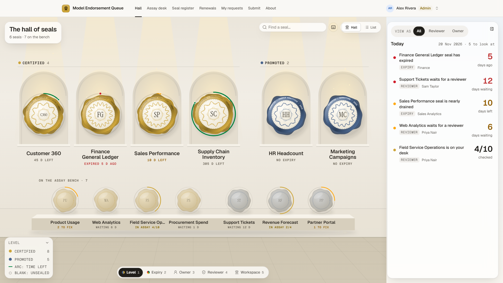

# Model Endorsement Queue

A request-and-review workflow for getting a semantic model **promoted** or **certified** in Microsoft Fabric. Owners
submit a model with a self-assessment against a versioned checklist; a reviewer claims it, passes or fails every item
with evidence, and approves, requests changes or rejects, always with a note. Every step lands in an append-only
decision trail. Certified approvals expire after 12 months, and the register flags models whose renewal is due or that
have expired. Fabric has endorsement badges but no review process around them: this is that process.

**Scope:** the app records the review. It does **not** set the badge in Fabric. After approving, the reviewer applies
the badge in Fabric (the model's **Settings → Endorsement**); the approval dialog and the approved request both say so.




## This repository

```text
apps/endorsement-queue/   the app: React + Vite frontend, Rayfin data model (rayfin/), tests, demo walkthrough
shared/         shared package (@x10/shared): data store, sign-in runtime, UI kit, charts
tools/          deploy, seed, SQL and secrets-check scripts
```

Quick start (no Fabric tenant needed, runs in demo mode with sample data):

```bash
npm install
npm run dev
```

## What it looks like

**The hall of seals.** Every endorsed model hangs in a lit niche as its own medallion, generated from its name: its
initials, a guilloché pattern, a gold scalloped ring for Certified or a slate ring for Promoted, and an outer arc that
drains toward renewal. Open requests sit on the assay bench as unstamped wax blanks, ringed with the reviewer's
progress; approving one presses the seal into wax.

- **Lenses** (keys 1–5): level, expiry, owner, reviewer, workspace. Each regroups and recolours the same seals.
- **View as** (V): all, reviewer or owner; what is not yours steps back, and **Today** re-ranks the three to five
  things that need attention. Each Today item flies to its seal and switches to its lens.
- **Tools:** the **Assay desk** (the queue, and per request the owner's claim and evidence beside the reviewer's
  pass/fail for every item, with a decision bar), the **Seal register** (table, trail check, CSV export) and
  **Renewals** (seals whose arc is nearly drained, with Start renewal). Also My requests, Submit (with a live preview
  of your blank) and About.
- **Fallbacks:** the hall is SVG (no WebGL needed, so `?nowebgl` shows the same hall), **L** switches to an
  accessible list of the same items, reduced motion stops the light, dust and stamp animations, and `?` lists the
  keyboard shortcuts. Screens for every page, both themes, desktop and phone: [docs/redesign](apps/endorsement-queue/docs/redesign).

Demo video (about 2 minutes, AI-generated narration, captions burned in): [demo/out/endorsement-queue.mp4](apps/endorsement-queue/demo/out/endorsement-queue.mp4) · captions file [demo/out/endorsement-queue.srt](apps/endorsement-queue/demo/out/endorsement-queue.srt).

## Prerequisites

- A Fabric tenant with the **Fabric Apps** workload (preview) enabled.
- A workspace on a Fabric capacity, and **Edit** (Contributor or higher) permission on it to deploy.
- Node.js 20 or later.
- Users need access to the app item (workspace members get it by default). No connector and no extra tenant setting
  is needed: this is a SQL-only app and uses authenticated access only (no anonymous data access).

## Run locally

```bash
npm install            # once, at the repository root
cd apps/endorsement-queue
npm run dev            # offline demo on http://localhost:5209 with seed data and a persona switcher
SCREENSHOTS=1 npx playwright test e2e/screenshots.spec.ts   # rewrite docs/redesign/*.png
npm run dev:fabric     # rayfin dev: the real Rayfin backend and Fabric sign-in
```

Demo personas (switch in the identity menu, or open with `?as=<sub>`):

| Persona | Sub | Role |
|---|---|---|
| Alex Rivera | `demo-reviewer-alex` | Reviewer (admin). Also owns *Procurement Spend*, so cannot claim it. |
| Jordan Lee | `demo-reviewer-jordan` | Reviewer (admin) |
| Sam Taylor | `demo-owner-sam` | Model owner |
| Priya Nair | `demo-owner-priya` | Model owner |

## Deploy

```bash
npx rayfin login
npx rayfin up --workspace-id <workspace-id>
```

`rayfin up` builds the app (`build:fabric`), deploys it, and applies schema changes too (new tables and columns).
Check health with `npx rayfin up status`.

## Seed

```bash
npm run seed:fabric -- --admin-email you@org.com
```

Inserts the demo data (skipped if the `seed:v1` marker row exists): 4 fictional people, **15 requests** across every
status and both levels (3 submitted, 2 in review, 2 changes requested, 6 approved, 1 rejected, 1 withdrawn), with the
6 approvals placed so that one certification expires in 10 days (renewal due), one expired 5 days ago, and one expires
in 45 days (shows on Renewals). Three requests use checklist **version 1**. Every request has full self-assessment
answers, reviewer answers where reviewed, and its event trail. Dates are relative to the moment you seed.

The full command from the repository root is
`node tools/seed-fabric.mjs --app endorsement-queue --admin-email you@org.com`. The seed's people are the four demo
personas; the script maps the **first persona** (Alex Rivera, the reviewer who also owns *Procurement Spend*) to the
real admin account you name, so the seeded reviews, claims and trail events attributed to that persona line up with
you (so in the seeded data you own *Procurement Spend* and cannot claim it, which demonstrates rule 2). Open the
deployed app once **before** running the script so your Person row exists; the script then also sets you as admin
(reviewer). To make someone else an admin by hand:

```sql
UPDATE dbo.People SET isAdmin = 1 WHERE email = 'you@org.com';
```

## How it works

### Entities

| Entity | Purpose | Key fields |
|---|---|---|
| `EndorsementRequest` | One request and its current state | modelName (3–120), workspace (≤100), modelUrl, ownerSub/ownerName, requestedLevel (`promoted`/`certified`), justification (10–1000), status (`submitted`, `in_review`, `changes_requested`, `approved`, `rejected`, `withdrawn`), reviewerSub/reviewerName, submittedAt, decidedAt, expiresAt, lastResubmittedAt, checklistVersion, renewalOfId |
| `ChecklistAnswer` | One answer to one item, append-only | requestId, itemKey, stage (`self` = owner, `review` = reviewer), result (`pass`/`fail`/`na`), evidence (≤300), answeredBySub/Name, answeredAt |
| `EndorsementEvent` | The decision trail, append-only | requestId, type (`submitted`, `claimed`, `changes_requested`, `resubmitted`, `approved`, `rejected`, `withdrawn`, `renewal_due`), bySub/byName, note (≤500), at |
| `Person`, `AppMarker` | Shared identity and seed marker | as generated |

### Rules (all in `src/domain/`, thresholds in `src/config/rules.ts`)

1. **Approve** only when every item the level needs is Pass, or N/A where allowed (rls, label, tests) **with evidence
   text**. `canApprove(request, answers)` in `approval.ts`, tested for both levels.
2. **Reviewer is never the owner.** A reviewer (admin) claims a submitted request (`in_review`) and is then the only
   reviewer who can record results and decide it (`claimBlocker`, `decideBlocker` in `workflow.ts`).
3. **Changes requested** returns the request to the owner with failing items highlighted. Resubmitting keeps all
   previous answers and clears only the failed ones (computed on read: reviewer "fail" answers older than
   `lastResubmittedAt` no longer count), and goes straight back to the same reviewer.
4. **Certified approval** sets `expiresAt` 12 months out (`certifiedValidityMonths`); promoted has no expiry.
5. **Register** chips are computed on read: renewal due within 30 days of expiry, expired after it. The first time an
   admin opens **Renewals** after a model's renewal date, one `renewal_due` event is written to that approval's trail
   (idempotent: skipped when one written by an admin exists; events by anyone else do not count).
6. **Reviewer must pass or fail every needed item** before any decision; every decision needs a note.
7. **Checklist versions** live in `src/config/checklist.ts` (`CHECKLISTS`, `CURRENT_CHECKLIST_VERSION`). Requests keep the
   version they were submitted with and are judged against it.
8. **Duplicates:** one open request per model and workspace (case and spaces ignored); a duplicate is blocked with a
   link to the open one.
9. **Owner leaving:** the owner fields are frozen at the database (see Security model), so the app does not offer
   reassignment. For an approved model the new owner starts a renewal (they become its owner). For an open request,
   the new owner submits their own once the old one is withdrawn, or the deployer reassigns it in SQL:
   `UPDATE dbo.EndorsementRequests SET ownerSub = '<sub>', ownerName = '<name>' WHERE id = '<id>';`
10. **Integrity:** `src/domain/integrity.ts` checks each request row against its trail. Events written by someone not
    allowed to write them (an owner event not by the owner, a reviewer event not by an eligible admin) are shown struck
    through and not counted; answers count only from the owner (self) or the claiming reviewer (review). A row whose
    status does not match its trail, or whose recorded reviewer is not eligible, is flagged on the request, in the
    queue, in My requests and in the register, and cannot be claimed or decided in the app.

Every status transition goes through `transition()` in `workflow.ts`, which writes exactly one event.

### Security model

| Entity | read | create | update | delete |
|---|---|---|---|---|
| EndorsementRequest | everyone signed in | `ownerSub = claims.sub` **and** `status = 'submitted'`; cannot set reviewerSub, reviewerName, decidedAt, expiresAt, lastResubmittedAt | `ownerSub = sub` **or** `reviewerSub = sub` **or** `status = 'submitted'`; only status, reviewerSub, reviewerName, decidedAt, expiresAt and lastResubmittedAt are writable (modelName, workspace, modelUrl, ownerSub, ownerName, requestedLevel, justification, submittedAt, checklistVersion, renewalOfId are frozen) | nobody |
| ChecklistAnswer | everyone | `answeredBySub = claims.sub` | nobody | nobody |
| EndorsementEvent | everyone | `bySub = claims.sub` | nobody | nobody |
| Person / AppMarker | as generated (isAdmin never writable from the client) | | | |

Enforced **by the database**: you can only create requests as yourself and only as `submitted`; nobody (not even the
owner) can change who owns a request or what it asks for (model, workspace, link, level, justification) after create;
other people's claimed or decided requests cannot be edited by anyone but their owner or claiming reviewer; answers
and events cannot be forged in someone else's name, edited or deleted. The update policy allows writes to an
unclaimed `submitted` row so a reviewer can claim it (see Known limits for exactly what that exposes).

Enforced **in domain code** (both demo and Fabric mode), because there is no admin claim: only admins claim and decide,
the reviewer is never the owner, only the claiming reviewer decides, status transitions follow the machine, notes and
checklist rules. `src/domain/policies.ts` mirrors the row policies, and the workflow tests run every flow through a
store wrapper that rejects any write the deployed API would reject.

**Tamper evidence:** the register cross-checks each approval against the append-only trail: an approval needs an
`approved` event written by an admin (Person.isAdmin can only be set with SQL), who is not the owner, who matches the
claiming reviewer, and a certified expiry no later than 12 months after that event. Anything else shows a red
"Trail mismatch" chip and is flagged in the CSV export.

## VERIFY outcomes and known limits

- Decorators, `@set` enums, `@int`, the policy DSL (`.eq`, `.and`, `.or`, string literals) and field `include/exclude`
  are as documented in the installed Rayfin 2.0 docs (see `shared/NOTES.md`). Entities typecheck against
  `@microsoft/rayfin-core` 2.0.
- **Known limit: admin-only actions are app-enforced.** The database cannot express "is admin" without dynamic auth
  claims (see Later), so through the GraphQL API, bypassing the app:
  - **Any signed-in user** can update the workflow fields of **any unclaimed `submitted` request**: `status`,
    `reviewerSub`, `reviewerName`, `decidedAt`, `expiresAt` and `lastResubmittedAt` (for example set it to
    `withdrawn`, or record themselves as reviewer). They cannot touch the owner, model, workspace, link, level or
    justification of anyone's request.
  - **The owner** can update those same workflow fields on **their own request at any status**, including after it
    is decided (for example set it to `approved` or push out `expiresAt`). The claiming reviewer can do the same on
    requests they claimed.
  - Answers and events are always stamped with the real author, so none of this can produce a valid trail. The app
    detects it (status vs trail, ineligible reviewer, events by the wrong person) and flags the request on every
    screen; the register shows "Trail mismatch" and marks it in the CSV, and the request cannot be claimed or decided
    in the app until the deployer repairs the row in SQL. It is detected, not prevented.
- **Links:** `modelUrl` is frozen after create (nobody, including the owner, can change it after approval) and is
  validated as http(s) on submit. It, and any evidence that is a web address, is rendered as a link only when it
  parses as http(s); anything else is shown as plain text, and the CSV export drops non-http(s) links.
- **Bundle contents:** like every Rayfin app, the Fabric build embeds the Rayfin API URL (which contains the tenant
  and workspace ids) and the publishable key in the JavaScript bundle. Neither is a secret: the key only identifies
  the app, and every data call still needs a signed-in Fabric user and passes the row policies. Nothing
  tenant-specific is committed to the repository.
- `renewal_due` events are written when an admin opens Renewals; two admins opening it at the same instant could each
  write one (harmless duplicate in the trail).
- Owner reassignment is not offered in the app (the owner fields are frozen at the database); see rule 9.
- The app does not set the endorsement badge in Fabric.

## Later

- Apply the badge through the Fabric REST API from a Rayfin Function after approval.
- Dynamic auth claims (`udf.authClaims`) so the database itself enforces reviewer-only claims and decisions.
- Email or Teams notifications on claim, decision and renewal due.
- Release a claim (hand a request back to the queue) and reviewer reassignment.
- Owner reassignment in the app (needs an admin claim, or a Function with elevated rights, so the owner columns can
  stay frozen for everyone else).

## Gallery

**Title:** 12 Days of Fabric Apps: Day [#] – [Theme]: Model Endorsement Queue

**Blurb (≤80 words):** A hall of seals for the models you tell people to trust. Every endorsed semantic model hangs as
its own medallion: gold for Certified, slate for Promoted, with an arc that drains toward renewal. Owners submit with
a self-assessment; a reviewer, never the owner, weighs each claim on the assay desk and strikes the seal. Lenses,
a Today list, a register with CSV and an append-only trail. It records the review; you apply the badge in Fabric.

**Tags:** Partner | 12 Days of Fabric Apps, Fabric Apps, Governance, Semantic models, Endorsement, Power BI

## License

MIT. See [LICENSE](LICENSE).
